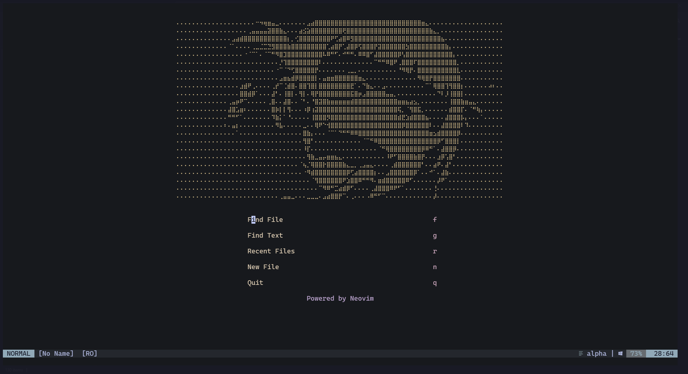
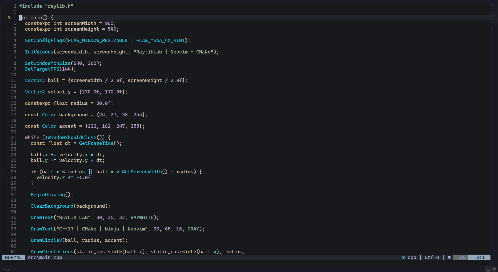
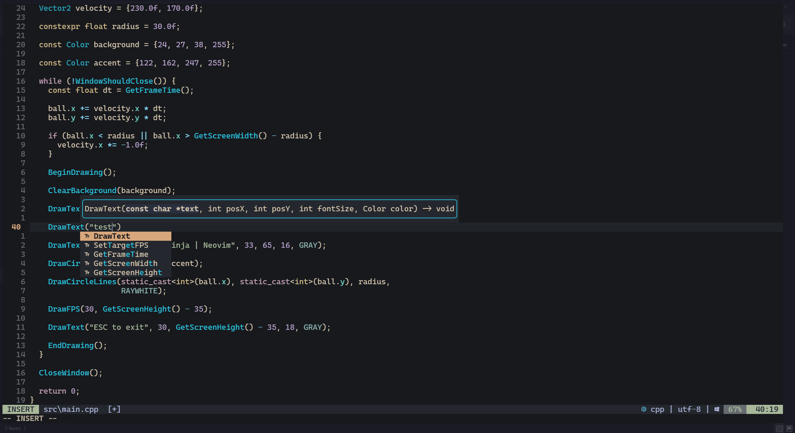

# Neovim Configuration

My personal Neovim configuration for C and C++ development, built around Lua and lazy.nvim.

## Screenshots

### Dashboard


### Editor


### Completion


## Features

- Lua-based configuration
- lazy.nvim plugin management
- LSP support
- Autocompletion
- Treesitter syntax highlighting
- Telescope fuzzy finder
- Neo-tree file explorer
- Lualine statusline
- Gitsigns
- CMake Tools integration
- Which-key keybinding discovery
- Autopairs

## Installation

Clone this repository:

```powershell
git clone https://github.com/CynicDev-cmd/nvim.git "$env:LOCALAPPDATA/nvim"
```

Install plugins by opening Neovim:

```powershell
nvim
```

Then run:

```vim
:Lazy sync
```

## Requirements

- Neovim
- Git
- A C/C++ compiler for C/C++ development
